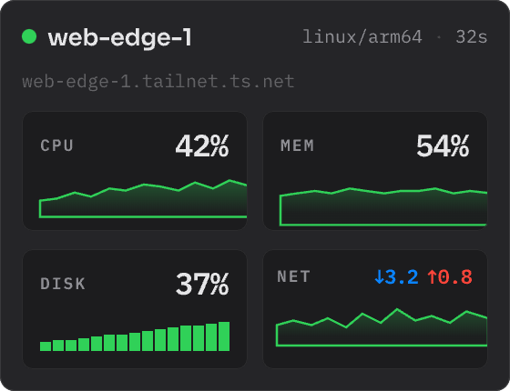
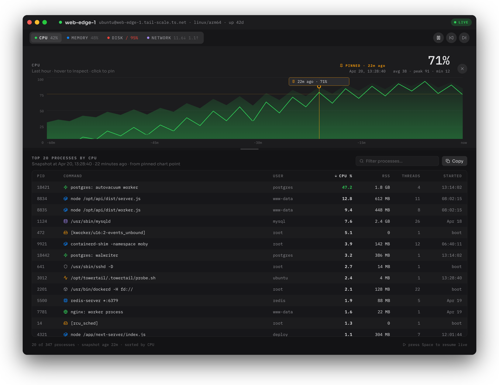

import { Steps, Aside } from '@astrojs/starlight/components';

Towertail connects to each server over SSH with a normal user account. It does not need root. The SSH server must allow SFTP, because Towertail copies the sampler with SFTP.

## Prepare an SSH key

Towertail reads these private key files on your Mac:

- `~/.ssh/id_ed25519`
- `~/.ssh/id_rsa`

<Aside type="caution">
Towertail does not read `~/.ssh/config`. It cannot use keys that have a passphrase, and it cannot use ECDSA keys. If you cannot use one of the two key files, use a password.
</Aside>

If you do not have a key, do these steps in Terminal:

<Steps>
1. Make an ed25519 key. Push Enter to accept the defaults:

    ```sh
    ssh-keygen -t ed25519
    ```

2. Copy the public key to the server:

    ```sh
    ssh-copy-id -i ~/.ssh/id_ed25519.pub user@host
    ```

3. Make sure that the login does not ask for a password:

    ```sh
    ssh user@host "echo ok"
    ```
</Steps>

In Towertail, the **Key setup help** button shows the same commands for the server that you add.

## Add a server

<Steps>
1. Click the Towertail icon in the menu bar.
2. Click the gear icon to open the settings.
3. Select the **Servers** tab.
4. Click the **+** button below the server list.
5. Type a **Name** for the server.
6. In **Kind**, select **SSH**.
7. In **Address**, type the user, the host name or IP address, and the port. The default port is 22.
8. In **Sign in with**, select **SSH key** or **Password**. Towertail keeps a password in the macOS Keychain.
9. Click **Add**.
10. With the new server selected, click **Test**.
</Steps>

The **Test** step does the first connection:

1. Towertail connects to the server.
2. It finds the operating system and the CPU architecture.
3. It copies the sampler to `~/.towertail/towertail-sampler` on the server.
4. It runs the sampler one time and shows the result.

After a good test, the server card shows live values in the popover.



To add many servers at one time, click **Import…** in the **Servers** tab. You can import from Tailscale, a CSV or TSV file, or a pasted list with one host on each line. For Tailscale, read [Tailscale](/docs/tailscale/).

## Host keys

At the first connection, Towertail accepts the host key of the server and keeps its fingerprint. If the host key changes later, Towertail refuses the connection.

If you replace the server and its key changes, select the server in the **Servers** tab. Then click **Forget** next to **Host key**. The next connection accepts the new key.

## Poll interval

Towertail polls each SSH server every 10 seconds by default. It polls **This Mac** every 2 seconds.

To change the interval, open the settings and select the **General** tab. Use the **Polling** section. The range is 1 to 300 seconds.

## Server details

Click a metric on a server card to open the full view of that server. The full view shows charts, the processes and the open ports.



To stop the polls of a server but keep it in the list, select the server in the **Servers** tab. Then turn off **Monitor this server**.
