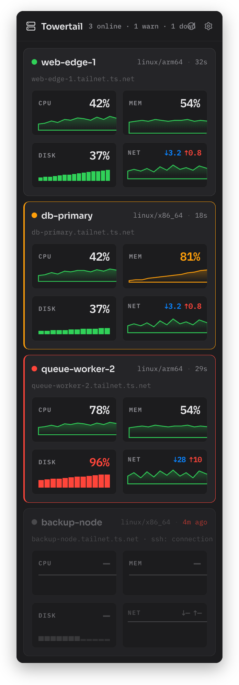

import { CardGrid, LinkCard } from '@astrojs/starlight/components';

Towertail is a macOS menu-bar app. It shows live CPU, memory, disk and network values for each of your servers. It connects to the servers over SSH. Tailscale is optional.

You do not install an agent on your servers. Towertail copies a small sampler binary to each server over SSH. At each poll, Towertail runs the sampler and reads one JSON sample. The sampler does not stay in memory and does not open a port.

## Requirements

- macOS 14 Sonoma or later.
- Servers that run Linux or macOS on x86_64 or arm64.
- SSH access to each server with a normal user account. You do not need root.

## Start

<CardGrid>
  <LinkCard title="Install" href="/docs/install/" description="Install Towertail with Homebrew or a zip file." />
  <LinkCard title="Add hosts" href="/docs/add-hosts/" description="Add a server and do the first connection." />
  <LinkCard title="Tailscale" href="/docs/tailscale/" description="Import the servers on your tailnet." />
  <LinkCard title="Thresholds" href="/docs/thresholds/" description="Set the warn and critical levels and the notifications." />
</CardGrid>

## Sampler

<CardGrid>
  <LinkCard title="How the sampler works" href="/docs/sampler/how-it-works/" description="What Towertail puts on your servers, and what it does." />
  <LinkCard title="Install the sampler as a service" href="/docs/sampler/service-install/" description="Send samples to a Towertail server with systemd or launchd." />
</CardGrid>

## Self-host

<CardGrid>
  <LinkCard title="Quick start" href="/docs/self-host/quick-start/" description="Start the Towertail server with Docker Compose." />
  <LinkCard title="Tokens" href="/docs/self-host/tokens/" description="Make tokens for the Mac app and for samplers." />
  <LinkCard title="Configuration" href="/docs/self-host/configuration/" description="All TT_* server settings." />
</CardGrid>

## For developers

- [Server wire contract](https://github.com/towertail/towertail/blob/main/docs/wire.md)
- [Sampler wire format](https://github.com/towertail/sampler/blob/main/docs/wire-format.md)
