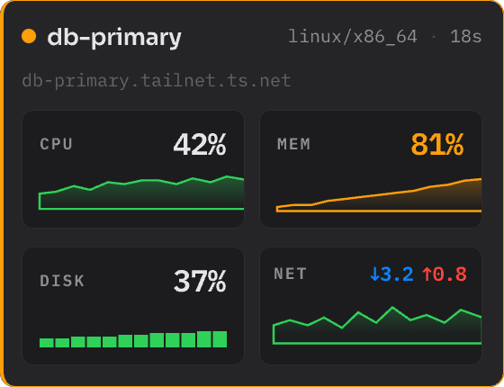
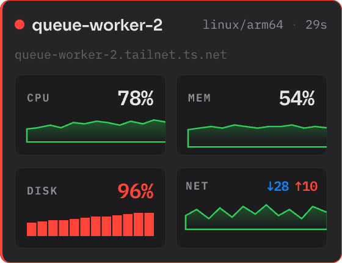
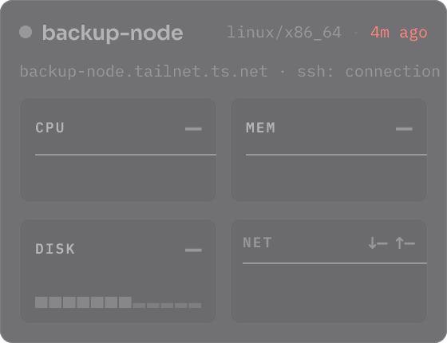

import { Steps, Aside } from '@astrojs/starlight/components';

Each metric has two levels: **warn** and **critical**. When a value is at or above a level, the card shows the value in the color of that level.

| Normal | Warn | Critical | Offline |
| --- | --- | --- | --- |
|  |  |  |  |

To change the levels, open the settings and select the **Alerts** tab.

## Default levels

| Metric | Warn | Critical | Alert after | Notify |
| --- | --- | --- | --- | --- |
| CPU | 75% | 90% | 5 min | Critical |
| Memory | 75% | 90% | 2 min | Warn + Critical |
| Disk | 85% | 95% | At once | Warn + Critical |

<Aside type="note">
Memory goes critical at once when the server has memory pressure. Without pressure, high memory only warns.
</Aside>

## Host health

Towertail also checks the health of each host. All health checks use one **Alert after** time. The default is 5 minutes. The default **Notify** setting is **Warn + Critical**.

| Check | Warn | Critical |
| --- | --- | --- |
| Processes | 5,000 | 20,000 |
| Zombies | 200 | 2,000 |
| PID use | 70% | 90% |
| Open files | 80% | 95% |
| Inodes | 85% | 95% |
| Memory pressure (PSI avg10) | 10% | 20% |
| I/O pressure (PSI avg10, full) | 20% | 40% |

The last five checks are below **More checks** in the **Alerts** tab.

## Alert timing

The card always shows the live value. The alert rules control the notifications and the color of the menu-bar icon.

- **Alert after** is the time that a metric must stay over the level before it alerts.
- **Over the line for at least** is the part of that time that must be over the level. The default is 80%. Thus a short drop below the level does not start the time again.

## Notifications

Notifications are off by default.

<Steps>
1. Open the settings and select the **Alerts** tab.
2. In **Notify on**, select **Critical** or **Warn + Critical**.
3. In **Repeat the same alert at most every**, select a time. The default is 1 min.
</Steps>

macOS asks for permission before the first notification. Click **Allow**.

Towertail sends a notification only when a metric goes up a level: from normal to warn, from normal to critical, or from warn to critical. A notification for CPU or memory shows the two processes that use the most.

Click a notification to open the full view of that server.

After your Mac wakes up or the network comes back, Towertail waits before it sends notifications. The default wait is 15 seconds. To change it, use **Post-wake grace** in the **General** tab.

## Snooze a server

To stop the notifications of one server for some time, right-click its card in the popover. Select **Snooze notifications** and a time, from 15 minutes to 1 week. To stop the snooze, right-click the card and select **Clear snooze**.

## Levels for one server

A server can override the default levels.

<Steps>
1. Open the settings and select the **Servers** tab.
2. Select the server.
3. Select **Alerts** at the top of the server details.
4. Click **Override** next to a metric, and change the levels.
</Steps>

Click **Revert** to use the default levels again. Turn on **Custom alert timing** to give the server its own alert timing.

For each server, you can also set **Notify on** and **Tint menu-bar icon on**. Use **Critical** for a server that is often in warn.

The **Server overrides** section of the **Alerts** tab shows all servers that override a default.

To set the default levels and the alert timing back to the factory values, click **Restore Defaults** in the **Alerts** tab. This does not change the server overrides.
